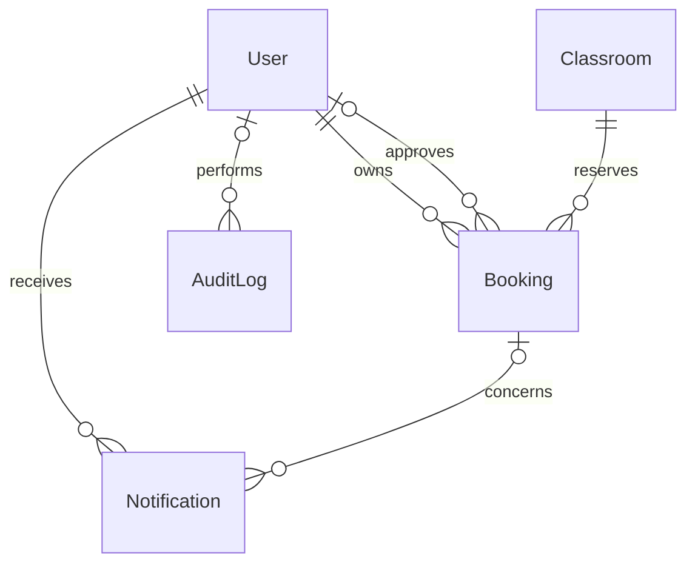
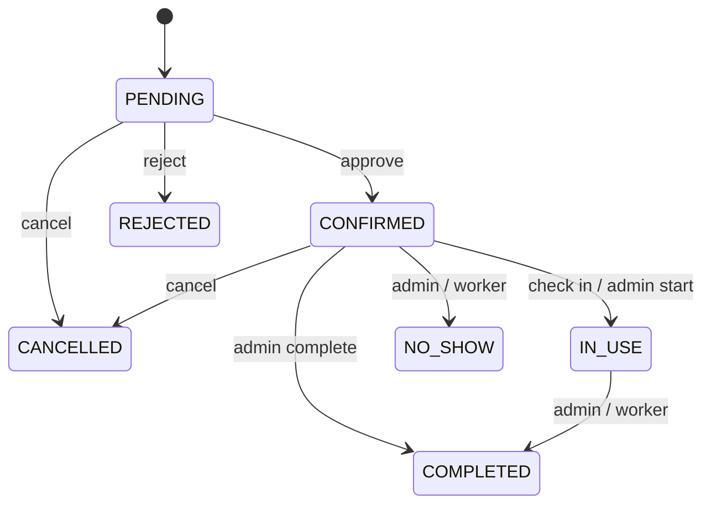

# Data model และสถานะของระบบ

[หน้าคู่มือ](./overview.md) · [ฟังก์ชัน](./functions.md) · [Services](./services.md) · [API](./api.md)

Source หลักคือ [schema.prisma](../../prisma/schema.prisma) ของ MySQL และ [schema.sqlite.prisma](../../prisma/schema.sqlite.prisma) สำหรับ SQLite แผนภาพเดิมอยู่ที่ [ERD](../db-erd.md) เมื่อต่างกันให้ตรวจ schema/migration ที่ใช้อยู่จริง

## ความสัมพันธ์

ทุก model มี BigInt primary key และ schema กำหนด autoincrement แต่ business code หลายจุดส่ง `newId()` เอง ส่วน seed ใช้ ID คงที่ ID ที่ตอบ API ผ่าน jsonSafe เป็น string

## User

| Field                     | ชนิด / เงื่อนไข            | ใช้ทำอะไร                                                          |
| ------------------------- | -------------------------- | ------------------------------------------------------------------ |
| id                        | BigInt PK                  | เจ้าของ booking, ผู้อนุมัติ, ผู้รับแจ้งเตือน, ผู้กระทำ audit       |
| userCode                  | String? unique, MySQL <=50 | identifier สำหรับ login แบบรหัสผู้ใช้                              |
| name                      | String <=150               | ชื่อแสดงหลักและใช้ค้นหา                                            |
| firstName/lastName        | String? <=100              | ข้อมูลโปรไฟล์; ชื่อย่อยไม่ได้ sync กลับ name อัตโนมัติทุก endpoint |
| phone                     | String? <=20               | เบอร์ผู้ใช้; route ใช้ regex ตรวจ input                            |
| email                     | String unique <=255        | login และข้อมูลติดต่อ                                              |
| passwordHash              | String <=255               | bcrypt hash; selections ของ profile/admin ไม่ส่งกลับ               |
| role                      | Role default USER          | สิทธิ์ที่ authenticate อ่านจาก database                            |
| status                    | UserStatus default ACTIVE  | ต้อง ACTIVE จึง authenticate/login ได้                             |
| tokenVersion              | Int default0               | เทียบ claim JWT; logout เพิ่มค่าเพื่อ revoke token เก่า            |
| createdAt/updatedAt       | DateTime now / @updatedAt  | เวลาสร้างและแก้ล่าสุด                                              |
| bookings/approvedBookings | Booking[] relations        | เจ้าของและผู้อนุมัติเป็นคนละ relation                              |
| notifications/auditLogs   | relations                  | ประวัติการแจ้งเตือนและการกระทำ                                     |

## Classroom

| Field               | ชนิด / เงื่อนไข                | ใช้ทำอะไร                                             |
| ------------------- | ------------------------------ | ----------------------------------------------------- |
| id                  | BigInt PK                      | booking.classroomId                                   |
| code                | String? unique <=50            | รหัสห้อง; API สร้างห้องบังคับแม้ schema อนุญาต null   |
| name/building       | String <=100                   | ชื่อห้องและอาคาร                                      |
| floor               | String <=50                    | ชั้นใน API เป็น string; admin validation บังคับเลขบวก |
| capacity            | Int                            | ความจุสูงสุดในการจอง                                  |
| description         | String? Text                   | คำอธิบาย; create route บังคับไม่ว่าง                  |
| category            | String? <=100                  | ประเภทห้อง; create route บังคับไม่ว่าง                |
| equipment           | Json?                          | array ชื่ออุปกรณ์สำหรับ filter และตรวจคำขอ            |
| imageUrl            | String? <=500                  | URL รูป; managedImageKey ใช้ตรวจว่าควรลบ R2 object ใด |
| status              | ClassroomStatus default ACTIVE | เปิด ปิด หรือซ่อมบำรุง                                |
| createdAt/updatedAt | DateTime                       | เวลา record                                           |
| bookings            | Booking[]                      | ประวัติการจองที่ทำให้ลบห้องจริงไม่ได้                 |

DELETE ห้องใช้การตรวจ booking.count ก่อนลบจริง ส่วน PATCH status INACTIVE เป็นการปิดใช้งานโดยเก็บข้อมูลและ relation ไว้

## Booking

| Field                                 | ชนิด / เงื่อนไข               | ใช้ทำอะไร                                                           |
| ------------------------------------- | ----------------------------- | ------------------------------------------------------------------- |
| id                                    | BigInt PK                     | reference ของ API, notification และ audit                           |
| bookingCode                           | String unique <=30            | รหัส BK-วันไทย-ID; seed ใช้ DEMO-*                                  |
| userId/classroomId                    | BigInt FK บังคับ              | เจ้าของและห้อง                                                      |
| purpose                               | String <=255                  | วัตถุประสงค์                                                        |
| attendeeCount                         | Int default1                  | ตรวจเทียบ capacity                                                  |
| requestedEquipment                    | Json?                         | อุปกรณ์ที่ขอ; route แปลงเป็น array JSON                             |
| description                           | String? Text                  | ข้อความประกอบ                                                       |
| startAt/endAt                         | DateTime บังคับ               | ช่วงใช้งานตาม instant; business rules แปลงวัน/เวลาเป็น Asia/Bangkok |
| status                                | BookingStatus default PENDING | state ของการจอง                                                     |
| adminNote                             | String? Text                  | หมายเหตุการอนุมัติ/ปฏิเสธ/เปลี่ยนสถานะ                              |
| approvedBy/approvedAt                 | BigInt? FK / DateTime?        | ผู้อนุมัติและเวลาอนุมัติ                                            |
| checkedInAt                           | DateTime?                     | เวลาเข้าสู่ IN_USE                                                  |
| completedAt                           | DateTime?                     | ใช้ทั้ง COMPLETED และ NO_SHOW ใน flow ปัจจุบัน                      |
| cancelledAt/cancelReason              | DateTime? / String? Text      | เวลายกเลิกและเหตุผล                                                 |
| createdAt/updatedAt                   | DateTime                      | เวลา record                                                         |
| user/classroom/approver/notifications | relations                     | เชื่อมข้อมูลรายละเอียดและแจ้งเตือน                                  |

Indexes: userId, classroomId, composite `(classroomId,startAt,endAt,status)`, status, startAt และ endAt ช่วย query ตามเจ้าของ ห้อง conflict และ worker การมี index ไม่ได้เป็น constraint กันช่วงเวลาทับกัน กติกานี้อยู่ใน query/transaction ของแอป

## Notification

| Field              | ชนิด / เงื่อนไข                  | ใช้ทำอะไร                                            |
| ------------------ | -------------------------------- | ---------------------------------------------------- |
| id/userId          | BigInt PK / FK                   | รายการและผู้รับ                                      |
| bookingId          | BigInt? FK                       | optional booking อ้างอิง                             |
| title/message/type | String / Text / String           | ข้อความและชนิด event; type เป็น string ไม่ใช่ enum   |
| dedupeKey          | String? unique, MySQL <=191      | ป้องกัน event ซ้ำเมื่อ caller ส่ง key                |
| isRead/readAt      | Boolean defaultfalse / DateTime? | สถานะอ่านและเวลาอ่านครั้งแรก                         |
| createdAt          | DateTime defaultnow              | เรียงรายการใหม่ก่อน                                  |
| user/booking       | relations                        | user ลบแบบ cascade; booking ลบทำ bookingId เป็น null |

Indexes: userId, bookingId, isRead ค่า readAt และ isRead เป็นสองฟิลด์ที่ route ปรับพร้อมกัน แต่ schema ไม่ได้บังคับความสอดคล้องด้วย constraint

## AuditLog

| Field             | ชนิด / เงื่อนไข     | ใช้ทำอะไร                                  |
| ----------------- | ------------------- | ------------------------------------------ |
| id                | BigInt PK           | รายการ audit                               |
| userId            | BigInt? FK          | null ได้ในงานระบบ เช่น lifecycle worker    |
| action/entity     | String              | ชนิดการกระทำและ domain เช่น UPDATE/BOOKING |
| entityId          | BigInt?             | ID ของ entity โดยไม่มี FK ไปแต่ละ model    |
| oldValue/newValue | Json?               | snapshots ที่ผ่าน jsonSafe                 |
| createdAt         | DateTime defaultnow | ลำดับประวัติ                               |
| user              | optional relation   | ข้อมูลผู้กระทำ; มี index userId            |

entityId ที่ไม่เป็น FK ทำให้ audit ยังเก็บ ID ของรายการที่ลบไปแล้วได้

## Enums

- Role: USER, STUDENT, TEACHER, ADMIN
- UserStatus: ACTIVE, INACTIVE, SUSPENDED
- ClassroomStatus: ACTIVE, INACTIVE, MAINTENANCE
- BookingStatus: PENDING, CONFIRMED, IN_USE, REJECTED, CANCELLED, COMPLETED, NO_SHOW

STAFF และ Classroom AVAILABLE เป็นค่าประวัติ migration ไม่ใช่ค่าปัจจุบัน ข้อความ error บางจุดยังใช้คำว่า staff แต่ delegatedRoles ใน source ปัจจุบันอนุญาต ADMIN เท่านั้น

## สถานะและการเปลี่ยนสถานะ

| จาก               | ไป        | ใคร / เงื่อนไข                                               | Field เพิ่ม                          |
| ----------------- | --------- | ------------------------------------------------------------ | ------------------------------------ |
| ไม่มี             | PENDING   | create booking ผ่าน validation/transaction                   | code, owner, room, start/end         |
| PENDING           | PENDING   | เจ้าของ/ADMIN แก้ไข และผ่าน validation ใหม่                  | ล้าง approvedAt/approvedBy/adminNote |
| PENDING           | CONFIRMED | ADMIN approve และไม่ชน CONFIRMED/IN_USE                      | approvedBy/approvedAt                |
| PENDING           | REJECTED  | ADMIN พร้อม adminNote                                        | adminNote                            |
| PENDING/CONFIRMED | CANCELLED | เจ้าของตาม cutoff หรือ ADMIN; มี admin action แยก            | cancelledAt/cancelReason             |
| CONFIRMED         | IN_USE    | check-in ภายใน early/late window ก่อน endAt หรือ ADMIN start | checkedInAt                          |
| CONFIRMED/IN_USE  | COMPLETED | ADMIN complete                                               | completedAt                          |
| IN_USE            | COMPLETED | worker เมื่อ endAt <= now                                    | completedAt                          |
| CONFIRMED         | NO_SHOW   | ADMIN เมื่อถึง startAt หรือ worker เมื่อเลย late cutoff      | completedAt                          |

Transition terminal ไม่ได้มี API เปิดกลับมา PENDING กติกา start/complete ของ ADMIN ไม่ได้ใช้ early/late check-in window เดียวกับ route ผู้ใช้

## MySQL เทียบกับ SQLite

ทั้งสอง schema มี models/enums/relations และ business fields ตรงกัน ความต่างหลักคือ provider และ MySQL native type attributes เช่น @db.VarChar/@db.Text Client ถูก generate ลงตำแหน่งเดิมจึงต้อง generate ใหม่เมื่อสลับ provider

Migration history ใน `prisma/migrations/` เป็น SQL ของ MySQL ส่วน SQLite ในเครื่องใช้ db push หรือ SQL schema ที่ export ผ่าน migrate diff ไม่ควรถือว่ารัน MySQL migration scripts กับ SQLite ได้โดยตรง การทดสอบ mock ไม่ยืนยันพฤติกรรม isolation/enum/JSON ของ provider ทั้งสอง

## Migration history ที่ต้องคงไว้

| Directory                                           | ความเปลี่ยนแปลงสำคัญ                                                             |
| --------------------------------------------------- | -------------------------------------------------------------------------------- |
| 20260914053000_baseline                             | ตารางและ relations ตั้งต้น รวมค่า enum เดิม                                      |
| 20260914120000_align_frontend_contract              | ชื่อย่อย userCode/phone, ข้อมูลห้องและ readAt, SUSPENDED และ enum ห้องในช่วงนั้น |
| 20260917090000_add_token_version                    | เพิ่ม tokenVersion default0                                                      |
| 20260920134000_rename_classroom_available_to_active | เปลี่ยน AVAILABLE เป็น ACTIVE                                                    |
| 20260920141000_keep_classroom_available_internal    | migration ช่วงกลางที่แปลงกลับ AVAILABLE                                          |
| 20260920212000_make_classroom_active_canonical      | ยืนยัน ACTIVE เป็นค่าปัจจุบันอีกครั้ง                                            |
| 20260920220000_remove_staff_role                    | แปลงผู้ใช้ STAFF เป็น ADMIN ก่อนตัด STAFF ออกจาก enum                            |

อย่ารวม/ลบ migration เก่าเพียงเพราะค่าบางตัวไม่ใช้แล้ว เพราะ deployment ที่ตาม history ต้องผ่านการแปลงข้อมูลตามลำดับ ส่วนการเพิ่ม schema ใหม่ให้สร้าง migration เพิ่มและปรับ SQLite schema ควบคู่กัน
