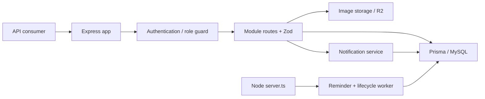

# คู่มือพัฒนาต่อระบบจองห้องเรียน: Backend

คู่มือภาษาไทยสำหรับผู้รับช่วงพัฒนา API, database และงานเบื้องหลัง อ้างอิง source ปัจจุบันที่ตรวจเมื่อ **31 ตุลาคม 2026** โดยอ่าน `package.json`/`package-lock.json`, `src/`, `prisma/`, `scripts/` และชุดทดสอบ เนื้อหาครอบคลุม backend เท่านั้น

## เริ่มอ่านจากตรงไหน

| ต้องการทำอะไร                                       | เอกสาร                                          |
| --------------------------------------------------- | ----------------------------------------------- |
| รู้เทคโนโลยี เวอร์ชัน และ environment ที่ต้องเตรียม | [Tech stack และ configuration](./tech-stack.md) |
| หาไฟล์ที่ควรแก้และกติกาจัดโฟลเดอร์                  | [โครงสร้างโครงการ](./structure.md)              |
| หา function, input, output และผลข้างเคียง           | [ทะเบียนฟังก์ชันทั้งหมด](./functions.md)        |
| เข้าใจ service, transaction, worker และ R2          | [Services และกระบวนการทำงาน](./services.md)     |
| หา URL, สิทธิ์, body/query และ response             | [API contract](./api.md)                        |
| เข้าใจตาราง ความสัมพันธ์ สถานะ และ migrations       | [Data model](./data-model.md)                   |
| รันในเครื่อง export SQLite หรือเพิ่ม feature        | [คู่มือพัฒนาและดูแลระบบ](./development.md)      |
| เขียนเทสต์และเข้าใจขอบเขตของ mock                   | [Vitest และการตรวจงาน](./testing.md)            |

โค้ดเป็นเอกสารอ้างอิงหลัก เมื่อเปลี่ยนพฤติกรรมให้ปรับคู่มือและ OpenAPI ตามกัน `README.md` ของ repository คงไว้ตามคำขอเดิม และข้อความเก่าใน README อาจไม่ครอบคลุมพฤติกรรมล่าสุด เช่นการเก็บรูปที่ R2 หรือการลบห้องจริง

## API functions ที่รับ HTTP request

อ่าน [api-functions.md](./api-functions.md) เพื่อดูฟังก์ชันของทุก endpoint ทีละตัว รวม request, ขั้นตอนภายใน, dependencies, response/error และ transaction ส่วน [api.md](./api.md) เป็นสัญญา URL/payload และ [functions.md](./functions.md) เป็น helper/service ที่เรียกใช้ซ้ำ

## ภาพรวมระบบ

Backend ใช้ Express 5 และ TypeScript ผ่าน Prisma เชื่อม MySQL ส่วน SQLite ใช้พัฒนาในเครื่อง รูปอยู่บน Cloudflare R2 แจ้งเตือนเป็นข้อมูล in-app ในฐานข้อมูล การเข้าสู่ระบบใช้ Bearer JWT โดยตรวจบัญชีและ tokenVersion ในฐานข้อมูลทุก request

Public routes ของ auth/classrooms ข้าม guard ตามที่แต่ละ router กำหนด ข้อผิดพลาดจาก handler ส่งเข้า error middleware กลาง ส่วน `/` และ `/health` ประกาศก่อน Helmet/CORS/logger

## การเริ่มทำงานสองแบบ

- [src/server.ts](../../src/server.ts) เปิด listener แล้วเริ่ม worker เหมาะกับ Node process ที่รันต่อเนื่อง ผ่าน `npm run dev` หรือ `npm start`
- [src/app.ts](../../src/app.ts) ประกอบและ export Express app โดยไม่เริ่ม listener/worker ใช้โดย Supertest และ entry point ของ serverless; การ import app อย่างเดียวไม่ทำให้ reminder/lifecycle ทำงาน
- เมื่อ import app จะโหลด env และสร้าง `imageStorage` จึงต้องมี configuration ที่ผ่าน Zod และระบุ R2 endpoint/account ได้ แม้กำลังเรียก endpoint ที่ไม่อัปโหลดรูป

## ขอบเขตแต่ละโมดูล

| โมดูล         | จุดเข้า              | หน้าที่                                                      |
| ------------- | -------------------- | ------------------------------------------------------------ |
| auth          | `/api/auth`          | register, login, logout, me                                  |
| classrooms    | `/api/classrooms`    | ค้นหาห้อง รายละเอียด availability และ schedule แบบสาธารณะ    |
| bookings      | `/api/bookings`      | จอง แก้ไข ยกเลิก check-in และ worker ตามเวลา                 |
| users         | `/api/users`         | โปรไฟล์ รหัสผ่าน ประวัติส่วนตัว และ directory สำหรับ admin   |
| notifications | `/api/notifications` | รายการของเจ้าของ จำนวนยังไม่อ่าน และอ่านแจ้งเตือน            |
| config        | `/api/config`        | ส่ง business rules ให้ API consumer                          |
| uploads       | `/api/admin/uploads` | อัปโหลด/ลบรูปด้วยสิทธิ์ ADMIN                                |
| admin         | `/api/admin`         | dashboard, จัดการห้อง/ผู้ใช้/booking, reports และ audit logs |

## ประเด็นที่ต้องรู้ก่อนแก้ระบบ

- สถานะที่ backend รับ/ส่งคือ `CONFIRMED` ส่วน `APPROVED` เป็นชื่อที่ frontend บางตัวแปลงใช้เอง
- `DELETE /api/bookings/:id` คือยกเลิก ส่วน `DELETE /api/admin/classrooms/:id` ลบห้องจริงเฉพาะเมื่อไม่มีประวัติ booking; การปิดห้องใช้ PATCH status เป็น `INACTIVE`
- ช่วงเวลาที่ทับกันใช้ `existing.startAt < endAt && existing.endAt > startAt` จึงจองต่อกันที่ขอบเวลาได้
- Create/update booking ใช้ serializable transaction และ retry P2034 ส่วน admin transition ใช้ transaction โดยไม่มี retry helper เดียวกัน
- Worker และหลาย route เขียนสถานะ/notification/audit แยกคำสั่งกัน การตอบ error จึงอาจเกิดหลังมีข้อมูลบางส่วนเปลี่ยนแล้ว ดูตาราง transaction ใน [services](./services.md)
- การเปลี่ยน password ยังไม่ได้เพิ่ม tokenVersion; การ logout เป็นเส้นทางที่เพิ่ม version เพื่อเพิกถอน JWT เดิม
- ชุด Vitest ใช้ Prisma/R2 mock ไม่ยืนยัน SQL, rollback, locking หรือ storage จริง

รายละเอียดเดิมเพิ่มเติม: [Business flow](../business-system-flow.md), [ERD](../db-erd.md), [export/restore SQLite](../../docs.md) เอกสารเหล่านี้ใช้ประกอบกับ source และคู่มือชุดนี้
