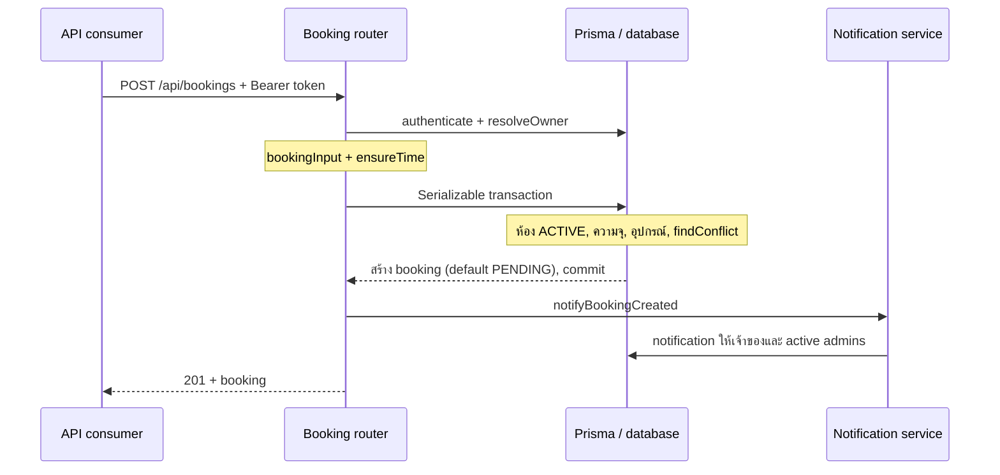

# Services และกระบวนการทำงาน

[หน้าคู่มือ](./overview.md) · [ฟังก์ชัน](./functions.md) · [Services](./services.md) · [API](./api.md)

## การแบ่งหน้าที่จริงใน source

โครงการไม่ได้แยก controller/repository ทุกโมดูล หลาย route ทำ validation และเรียก Prisma ใน handler โดยตรง service ที่แยกเป็นไฟล์มี booking worker, notifications, image storage และ admin audit ส่วน booking helpers กับ `changeBookingStatus` ยังเป็นฟังก์ชันภายใน route file

| จุดรับผิดชอบ            | Source                                                                                | Dependency หลัก                        |
| ----------------------- | ------------------------------------------------------------------------------------- | -------------------------------------- |
| จอง/แก้/ยกเลิก/check-in | [bookings.routes.ts](../../src/modules/bookings/bookings.routes.ts)                   | env, Prisma, notification service      |
| เปลี่ยนสถานะโดย admin   | [admin-bookings.routes.ts](../../src/modules/admin/admin-bookings.routes.ts)          | Prisma transaction, safeUser           |
| แจ้งเตือน in-app        | [notification.service.ts](../../src/modules/notifications/notification.service.ts)    | Prisma user/notification, newId        |
| Reminder/lifecycle      | [booking-reminder.service.ts](../../src/modules/bookings/booking-reminder.service.ts) | env, Prisma booking/notification/audit |
| รูปภาพ                  | [image-storage.service.ts](../../src/modules/uploads/image-storage.service.ts)        | S3 SDK, crypto UUID, env, AppError     |
| Audit กลางของ admin     | [admin-audit.service.ts](../../src/modules/admin/admin-audit.service.ts)              | Prisma auditLog, newId, jsonSafe       |
| รายงาน                  | [admin-reports.routes.ts](../../src/modules/admin/admin-reports.routes.ts)            | Prisma, Intl, reportFilter/reportWhere |

ชื่อฟังก์ชันพร้อม input/output ครบอยู่ใน [ทะเบียนฟังก์ชัน](./functions.md)

## Booking: ตั้งแต่รับคำขอจนสร้างสำเร็จ

1. `authenticate` ตรวจ token และ user ล่าสุด; `resolveOwner` ตรวจเจ้าของ ACTIVE และอนุญาตการจองแทนเฉพาะ ADMIN
2. `bookingInput` coercion ID/Date และ `ensureTime` ตรวจระยะเวลา/วันไทยก่อน transaction
3. ภายใน transaction อ่านห้อง ตรวจ ACTIVE/ความจุ/อุปกรณ์ และค้นหารายการทับช่วงใน PENDING/CONFIRMED/IN_USE
4. สร้าง ID และ booking code; status ใช้ database default PENDING
5. หาก Prisma แจ้ง P2034 ให้ retry transaction ทั้งชุดสูงสุดสาม attempts; error อื่นส่งออกทันที ไม่มี retry ของการส่ง notification
6. หลัง commit เรียกแจ้งเตือน; notification error ถูก log และยังส่ง booking สำเร็จ Create path นี้ไม่ได้สร้าง audit log ของ action CREATE

การตรวจ availability จาก endpoint แยกเป็นผล ณ เวลาที่อ่านเท่านั้น การ create/update จึงยังต้องตรวจ conflict ภายใน transaction ของตนเอง

### แก้ไขรายการ

- เจ้าของหรือ ADMIN แก้ได้เฉพาะ PENDING
- รวมค่าที่ไม่ได้ส่งกับรายการเดิมก่อนตรวจเวลา ห้อง จำนวนคน อุปกรณ์ และ conflict โดยข้าม ID ของตัวเอง
- เขียน booking ใน transaction และล้าง approvedAt/approvedBy/adminNote
- หลัง commit เขียน audit UPDATE ด้วย prisma กลาง แล้วแจ้งเจ้าของ/admin
- audit failure ส่ง error ให้ผู้เรียกได้แม้ booking เปลี่ยนแล้ว ส่วน notification failure ถูก catch

### ยกเลิกและ check-in

- `cancelBooking` ใช้กับ PATCH cancel และ DELETE booking เหมือนกัน: PENDING/CONFIRMED เท่านั้น; ผู้ใช้ต้องเหลือเวลาก่อนเริ่มไม่น้อยกว่า cutoff ส่วน ADMIN ข้าม cutoff ได้
- การยกเลิกบันทึก CANCELLED/cancelledAt/cancelReason แล้ว `cancelAndNotify` จึง audit และแจ้งเตือน
- Check-in ต้อง CONFIRMED, อยู่ระหว่าง `startAt - earlyMinutes` ถึง `startAt + lateMinutes` โดยรวมสองขอบ และ `now < endAt`
- Check-in update เป็น IN_USE/checkedInAt ก่อนเขียน audit และแจ้งเตือน; เส้นทางนี้ไม่มี transaction ครอบทั้งชุด
- กรณีไม่พบหรือไม่ใช่เจ้าของ/ADMIN ใช้ 404 เหมือนกัน

## Admin transition: changeBookingStatus

ก่อนเข้า transaction จะอ่าน booking และตรวจ transition ตาม [state table](./data-model.md#สถานะและการเปลี่ยนสถานะ) จากนั้น transaction ทำงานดังนี้:

1. ถ้าอนุมัติเป็น CONFIRMED ตรวจทับซ้อนกับ CONFIRMED/IN_USE ของห้องเดียวกันและข้าม booking ตัวเอง; PENDING ของรายการอื่นไม่อยู่ใน query นี้
2. update status/adminNote และ timestamp ของ action นั้น เช่น approvedAt/checkedInAt/completedAt/cancelledAt
3. สร้าง notification ของเจ้าของ type `BOOKING_<สถานะใหม่>`
4. สร้าง audit พร้อม snapshot ก่อน/หลังและ admin ผู้กระทำ

ทั้งสามการเขียนใน transaction จะ rollback ด้วยกันเมื่อคำสั่งภายในล้มเหลว แต่การอ่าน/ตรวจสถานะครั้งแรกอยู่ก่อน transaction และไม่มี helper retry P2034 เหมือน create/update ฝั่งผู้ใช้ จึงต้องออกแบบการตรวจ concurrency เพิ่มหากจะเปลี่ยน flow นี้

## Notification service

ทั้งหมดเป็น **in-app records** ไม่มี email/SMS/push provider อยู่ใน service นี้

| Function               | ผู้รับ                  | Type                                  |
| ---------------------- | ----------------------- | ------------------------------------- |
| createNotification     | userId ที่รับเข้า       | type ที่ caller กำหนด                 |
| notifyActiveAdmins     | ADMIN ที่ ACTIVE ทุกคน  | type ที่ caller กำหนด                 |
| notifyBookingCreated   | เจ้าของ / active admins | BOOKING_CREATED / BOOKING_PENDING     |
| notifyBookingUpdated   | เจ้าของ / active admins | BOOKING_UPDATED / BOOKING_UPDATED     |
| notifyBookingCancelled | เจ้าของ / active admins | BOOKING_CANCELLED / BOOKING_CANCELLED |
| notifyBookingCheckedIn | เจ้าของ / active admins | BOOKING_IN_USE / BOOKING_IN_USE       |

`createNotification` สร้าง ID ใหม่แล้วส่ง input ต่อให้ Prisma โดยไม่ validate เพิ่ม `notifyActiveAdmins` และฟังก์ชันแจ้งสองกลุ่มใช้ Promise.all จึงอาจสร้างบาง notification สำเร็จก่อนอีกอันล้มเหลว ไม่มี transaction/outbox/retry queue ครอบชุดนี้ ค่า dedupeKey เป็น optional และใช้ป้องกันซ้ำเฉพาะ caller ที่ระบุ

Notification routes กรอง userId จาก req.user เสมอ `read-all` เปลี่ยนเฉพาะที่ยังไม่อ่าน ส่วน `/:id/read` เก็บ readAt เดิมเมื่อเคยอ่านแล้วเพื่อไม่เปลี่ยนเวลาอ่านครั้งแรก

## Booking reminder และ lifecycle worker

`startBookingReminderWorker()` เรียกสอง sweep ทันทีผ่าน Promise.all แล้วเรียกซ้ำตาม REMINDER_POLL_INTERVAL_MS พร้อม log failure ใช้ timer.unref() และคืน timer เพื่อ clearInterval ได้

### runBookingReminderSweep(now)

- อ่าน CONFIRMED ที่ `startAt > now` และ `startAt <= now + BOOKING_REMINDER_MINUTES`
- process-local flag `running` กัน reminder sweep ซ้อนเฉพาะ process เดียวกัน
- ใช้ key `booking-reminder:<bookingId>` ตรวจมีแล้วก่อนสร้าง และ catch Prisma P2002 อีกชั้นสำหรับการแข่งขันข้าม process
- สร้าง BOOKING_REMINDER ให้เจ้าของ; คืนจำนวนที่สร้างจริงและคืน guard ใน finally แม้เกิด error

### runBookingLifecycleSweep(now)

| กลุ่ม    | เงื่อนไขอ่าน                           | การเปลี่ยน              | Side effects                                                    |
| -------- | -------------------------------------- | ----------------------- | --------------------------------------------------------------- |
| no-show  | CONFIRMED, startAt < now - lateMinutes | NO_SHOW + completedAt   | BOOKING_NO_SHOW, dedupe booking-no-show:id, audit NO_SHOW       |
| complete | IN_USE, endAt <= now                   | COMPLETED + completedAt | BOOKING_COMPLETED, dedupe booking-completed:id, audit COMPLETED |

แต่ละรายการใช้ updateMany ที่มี ID และสถานะเดิมใน where หาก count เป็น 0 จะข้าม side effects เพื่อไม่ทับสถานะที่ process อื่นเพิ่งเปลี่ยน ไม่มี running flag ของ lifecycle ทั้งชุดและไม่มี transaction รวม update/notification/audit หาก side effect ล้มเหลวหลัง update แล้ว รอบถัดไปอาจไม่พบรายการในสถานะเดิมเพื่อทำซ้ำ จึงไม่ควรถือว่ามีการส่งอย่างน้อยหนึ่งครั้งหรือส่งสำเร็จแน่นอน

`server.ts` เป็นผู้เริ่ม worker; default export ของ `app.ts` ไม่ได้เริ่ม หากรันเฉพาะ serverless app ต้องจัดกลไกเรียก sweep ในสภาพแวดล้อมนั้นเพิ่มก่อนคาดหวังงานตามเวลา

## R2 image storage

### อัปโหลด

`uploads.routes.ts` ใช้ Multer memoryStorage จำกัด 5 MB และ MIME JPEG/PNG/WebP/GIF ภายใต้สิทธิ์ ADMIN จากนั้น `R2ImageStorage.save(file)`:

1. resolveExtension จาก MIME
2. สร้าง UUID key ใหม่พร้อมนามสกุล
3. PutObject ไป bucket โดยใช้ buffer, ContentType และ `public, max-age=31536000, immutable`
4. คืน `{ key, url }` โดยประกอบ URL จาก R2_PUBLIC_BASE_URL

การตรวจ MIME ใช้ค่าที่ file ส่งมา; ไม่มีการ decode ภาพตรวจ signature, resize หรือสแกนไฟล์ใน source ปัจจุบัน แต่ละการอัปโหลดเป็น object ใหม่แยกจากการ create/update ห้อง

### ลบรูปโดยตรงกับการลบห้อง

- `remove(key)` ตรวจ basename/pattern ก่อน DeleteObject; error จาก SDK ส่ง caller
- `managedImageKey(imageUrl)` คืน key เฉพาะ origin เดียวกับ R2_PUBLIC_BASE_URL, path ชั้นเดียวที่ decode แล้วและผ่าน assertSafeKey; URL อื่นคืน null
- DELETE ห้องตรวจ `booking.count` ทุกสถานะ หากมี booking ส่ง 409 และให้ใช้การปิดใช้งานแทน
- หากไม่มี booking และ URL เป็นรูปที่ระบบดูแล จะพยายามลบ R2 ก่อน; ถ้า storage ล้มเหลวให้ console.warn แล้วดำเนินการลบ record ห้องต่อ
- ลบห้องด้วย prisma.classroom.delete แล้ว audit DELETE พร้อมค่าเก่า ขั้นตอน R2/database/audit ไม่เป็น transaction เดียวกัน
- create/update ห้องที่รับ imageUrl ไม่ได้เรียก storage cleanup ของรูปเดิมโดยอัตโนมัติ

Instance imageStorage สร้างตอน import จึงตรวจ endpoint configuration ใน constructor แม้ request ยังไม่เกิด การสร้าง S3Client เองยังไม่ทำ network call

## Audit service และขอบเขต transaction

`audit(userId, action, entity, entityId, oldValue?, newValue?)` สร้าง AuditLog ผ่าน Prisma กลางและใช้ jsonSafe สำหรับ snapshot ไม่ได้รับ tx client จาก caller จึงไม่ได้รวมกับการเขียนก่อนหน้าโดยอัตโนมัติ

| Flow                       | สิ่งที่อยู่ใน transaction เดียว                                | สิ่งที่อยู่นอก transaction                        |
| -------------------------- | -------------------------------------------------------------- | ------------------------------------------------- |
| สร้าง booking              | ห้อง/conflict query และ booking.create                         | auth/owner/time prechecks, notifications          |
| แก้ booking                | ห้อง/conflict query และ booking.update                         | status/owner/time prechecks, audit, notifications |
| Admin booking transition   | conflict query ขณะอนุมัติ, booking.update, notification, audit | อ่าน booking/ตรวจสถานะครั้งแรก                    |
| Cancel/check-in ผู้ใช้     | ไม่มี transaction รวมชุด                                       | booking update → audit → notification             |
| Reminder                   | ไม่มี transaction รวมชุด                                       | lookup/dedupe/create แยกกัน ใช้ unique key เสริม  |
| Lifecycle                  | atomic updateMany เฉพาะคำสั่งเปลี่ยนสถานะ                      | notification/audit หลัง update                    |
| จัดการห้อง/ผู้ใช้ของ admin | ไม่มี transaction รวม write+audit                              | แก้ record แล้วเรียก audit กลาง                   |
| ลบห้อง                     | ไม่มี transaction ระหว่าง R2/DB/audit                          | ทั้งสามขั้นแยกกัน                                 |

## รายงานและเวลา

- reportDateBoundary ทำ date-only เป็นวันไทยทั้งวัน ส่วน ISO ใช้เวลาที่ระบุ ขอบบน date-only เป็นต้นวันถัดไปแบบ exclusive
- reportWhere เลือกรายการที่ทับช่วง ไม่จำกัดเฉพาะเวลาเริ่มอยู่ในช่วง
- reportsSummary เป็นยอดรวมทั้งหมด และกราฟของรายการที่เริ่มภายในเจ็ดวันล่าสุดตาม Asia/Bangkok ไม่รับ report filters
- totalHours ของรายห้องรวม duration เต็มของ booking ที่ผ่าน filter ไม่ตัด duration ให้เหลือเฉพาะส่วนที่ทับช่วงรายงาน
- CSV escape double quotes, เวลาไทยพร้อมเดือนย่อไทย/ปี ค.ศ. และ UTF-8 BOM; การ escape CSV นี้ไม่ได้แปลงค่าที่ขึ้นต้นด้วยสูตรให้เป็นข้อความพิเศษ

## เมื่อต้องเพิ่ม service ใหม่

ระบุ input/output และเจ้าของการจัดการ error ให้ชัด เลือกขอบเขต transaction ก่อนเชื่อม side effects ภายนอก ถ้าต้องทำงานใน transaction ให้รับ `Prisma.TransactionClient` อย่างชัดเจนแทนการเรียก prisma กลางใน helper โดยไม่ตั้งใจ และเพิ่มเทสต์ทั้งกรณีสำเร็จ/ล้มเหลว/การแข่งขันที่เกี่ยวข้อง
